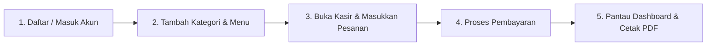

# QuickPOS - Sistem Kasir & Manajemen Stok Cloud untuk UMKM & F&B

> [English (Primary)](README.md) | Bahasa Indonesia

**QuickPOS** adalah aplikasi web kasir (Point of Sale) dan manajemen stok modern berbasis Laravel 11. Aplikasi ini dirancang khusus untuk mempermudah operasional Usaha Mikro, Kecil, dan Menengah (UMKM) seperti kedai kopi (coffee shop), kafe, rumah makan, warkop, dan toko kelontong melalui sistem multi-user yang cepat, aman, dan mudah digunakan.

---

## Masalah yang Diselesaikan

### Permasalahan Nyata UMKM
1. **Pencatatan Manual & Selisih Kas:** Nota kertas dan kalkulator manual sering memicu salah hitung nominal, nota terselip, hingga selisih uang kas harian.
2. **Stok Menu Tidak Terkontrol:** Penjualan menu yang fisiknya sudah habis sering terjadi karena tidak adanya sistem pengurang stok otomatis secara real-time.
3. **Pencampuran Data Antar Pemilik:** Pelaku usaha membutuhkan aplikasi kasir yang datanya terisolasi dan mandiri tanpa khawatir data menunya tercampur dengan usaha lain.
4. **Sistem Kasir Konvensional yang Rumit:** Sebagian besar software POS di pasaran berbiaya langganan tinggi, rumit dipelajari, dan lambat saat jam sibuk (rush hour).

### Solusi dari QuickPOS
* **Terminal Kasir Kilat:** Antarmuka satu layar yang responsif dan interaktif untuk mempercepat input pesanan pelanggan.
* **Manajemen Stok Otomatis & Aman:** Pengurangan stok otomatis dengan transaksi database dan penguncian (pessimistic locking / lockForUpdate) untuk mencegah pesanan ganda saat stok terbatas.
* **Multi-Tenant Terisolasi:** Setiap akun toko yang terdaftar memiliki database kategori, produk, transaksi, dan riwayat terpisah yang aman (user_id scoping).
* **Rekap Keuangan Otomatis & Ekspor PDF:** Laporan omzet bulanan, produk terlaris, dan log transaksi lengkap yang dapat langsung diunduh ke format PDF untuk pembukuan akuntansi.

---

## Fitur Unggulan

* **Terminal Kasir (POS):**
  * Pencarian instan menu berdasarkan nama atau kategori.
  * Keranjang belanja interaktif dengan kalkulasi otomatis subtotal dan total bayar.
  * Peringatan visual otomatis jika stok produk habis atau tidak mencukupi.
  * Modal konfirmasi transaksi dan status proses yang jelas.
* **Manajemen Menu & Kategori:**
  * CRUD lengkap untuk kategori dan produk makanan/minuman.
  * Validasi unik nama menu & kategori per masing-masing toko/user.
  * Fitur Soft Delete: produk yang dihapus tidak akan merusak riwayat transaksi dan audit keuangan masa lalu.
* **Dashboard Analitik Bisnis:**
  * Ringkasan omzet hari ini dan omzet bulan berjalan.
  * Total transaksi bulanan.
  * Pemantau produk terlaris (best seller).
  * Notifikasi peringatan stok kritis (stok &le; 5 item).
* **Riwayat Transaksi & Laporan Keuangan:**
  * Filter riwayat transaksi berdasarkan bulan dan tahun.
  * Rincian nota belanja lengkap (nama menu, qty, harga per unit, dan subtotal).
  * Fitur ekspor laporan keuangan format PDF (menggunakan Barryvdh DomPDF).
* **Akun & Keamanan Data:**
  * Sistem registrasi, login, dan reset password dengan token email.
  * Pengaturan identitas toko, email, dan kata sandi.
  * Validasi harga mutlak di sisi server untuk mencegah manipulasi data dari browser.

---

## Teknologi yang Digunakan

* **Backend:** PHP 8.2+, Laravel 11
* **Database:** MySQL / MariaDB
* **Frontend:** Laravel Blade, Tailwind CSS, JavaScript (Fetch API)
* **Ikon:** FontAwesome 6
* **Ekspor PDF:** barryvdh/laravel-dompdf

---

## Panduan Instalasi & Menjalankan Proyek

### Prasyarat Sistem
* PHP >= 8.2 (ekstensi PDO, OpenSSL, Mbstring aktif)
* Composer
* Node.js & NPM
* Server Database MySQL atau MariaDB

### Langkah-Langkah Instalasi

1. **Clone repository:**
   ```bash
   git clone <url-repository>
   cd TUGAS-PPLG-APLIKASI-WEB-KASIR-SEDERHANA
   ```

2. **Pasang dependensi PHP dan Node:**
   ```bash
   composer install
   npm install
   ```

3. **Konfigurasi Environment:**
   ```bash
   cp .env.example .env
   php artisan key:generate
   ```
   Buka file `.env` dan sesuaikan koneksi database Anda:
   ```env
   DB_CONNECTION=mysql
   DB_HOST=127.0.0.1
   DB_PORT=3306
   DB_DATABASE=db_kasir
   DB_USERNAME=root
   DB_PASSWORD=
   ```

4. **Jalankan Migrasi Database & Seeder:**
   ```bash
   php artisan migrate --seed
   ```

5. **Build Aset Frontend & Jalankan Server Lokal:**
   ```bash
   # Terminal 1: Kompilasi aset frontend
   npm run build

   # Terminal 2: Jalankan web server Laravel
   php artisan serve
   ```
   Buka browser dan akses aplikasi melalui `http://127.0.0.1:8000`.

---

## Panduan Penggunaan Aplikasi



### 1. Masuk ke Akun
* Buka halaman `/login` atau buat akun baru di `/create/auth/admin/user/register`.
* Anda dapat mengubah nama toko dan profil melalui menu **Settings**.

### 2. Pengaturan Kategori & Menu Toko
* Buka menu **Kategori**: Tambahkan kelompok produk Anda (misal: Kopi, Makanan Berat, Snack).
* Buka menu **Menu**: Daftarkan nama produk, tentukan kategorinya, isi harga jual, dan jumlah stok awal.

### 3. Melayani Transaksi (Menu Kasir / POS)
* Buka menu **Kasir**.
* Klik kartu produk atau gunakan kolom pencarian untuk memasukkan menu ke keranjang.
* Atur jumlah pesanan menggunakan tombol `+` atau `-`. Subtotal dan total akan dihitung otomatis.
* Klik tombol **Bayar**, periksa kembali rincian di modal konfirmasi, lalu konfirmasi transaksi.
* Sistem akan memproses transaksi dan memotong stok di database secara otomatis.

### 4. Evaluasi & Cetak Laporan
* Buka **Dashboard** untuk memantau omzet harian, status stok kritis, dan menu terlaris.
* Buka menu **Riwayat Transaksi** untuk melihat seluruh nota penjualan sebelumnya.
* Pilih bulan dan tahun yang ingin dianalisis.
* Klik tombol **Export Laporan (PDF)** untuk mengunduh rekap keuangan siap cetak.

---

## Lisensi
Proyek ini bersifat open-source di bawah lisensi [MIT License](LICENSE).
