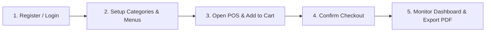

# QuickPOS - Smart Cloud Point of Sale for MSMEs & F&B

> English (Primary) | [Bahasa Indonesia](README.id.md)

**QuickPOS** is a modern, lightweight, multi-tenant Point of Sale (POS) and inventory web application built with Laravel 11. Specifically engineered for micro, small, and medium enterprises (MSMEs / UMKM) such as coffee shops, food stalls, retail stores, and local cafes, QuickPOS streamlines cash register transactions, real-time stock management, and financial reporting.

---

## Problem Statement & Solution

### The Problems MSMEs Face
1. **Manual Logbooks & Calculation Errors:** Recording sales and calculating totals on paper often leads to miscalculations, lost records, and cash discrepancies.
2. **Stock Discrepancies:** Selling items that are actually out of stock due to the lack of real-time inventory updates.
3. **Multi-Store Data Mixing:** Independent business owners or tenants need isolated accounts without risking data leaks across different stores.
4. **Complicated Setup:** Most existing enterprise POS software is overly complex, costly, and requires steep training curves.

### The Solution Provided by QuickPOS
* **Instant Cashier Workflow:** An intuitive, single-screen interactive POS terminal designed for speed during peak hours.
* **Concurrency-Safe Inventory Deduction:** Automated stock decrement protected with database transactions and pessimistic locking (`lockForUpdate`) to eliminate overselling and race conditions.
* **Isolated Multi-Tenancy:** Each registered account manages its own separate product catalog, categories, financial statistics, and sales history.
* **Monthly Financial Reporting & PDF Export:** One-click automated revenue calculation, best-seller tracking, and professional PDF summary reports for monthly financial reconciliations.

---

## Key Features

* **Interactive POS Interface:**
  * Real-time search by menu name or category.
  * Live responsive shopping cart with automatic subtotal and total calculations.
  * Instant out-of-stock validation and visual warnings.
  * Interactive transaction confirmation and receipt modals.
* **Menu & Category Management:**
  * Full CRUD (Create, Read, Update, Delete) operations.
  * Scoped validation ensuring category and menu uniqueness per store.
  * Integrated Soft Delete: deleting a product keeps historical transactions and reports intact.
* **Business Insights Dashboard:**
  * Today's revenue vs. current month's revenue overview.
  * Total transactions processed.
  * Best-selling menu item indicator.
  * Low-stock warning alert (items with stock &le; 5 units).
* **Sales History & Reporting:**
  * Filter transactions by month and year with preserved pagination state.
  * Detailed invoice breakdown showing quantities, items, and unit prices.
  * One-click PDF download for monthly financial reports via Barryvdh DomPDF.
* **Account & Security Settings:**
  * Multi-user authentication (Register, Login, Password Reset with email token).
  * Profile management (Store Name, User Email, and Password update).
  * Server-side price enforcement to prevent client-side manipulation.

---

## Tech Stack

* **Backend:** PHP 8.2+, Laravel 11
* **Database:** MySQL / MariaDB
* **Frontend:** Blade Templating, Tailwind CSS, JavaScript (Fetch API)
* **Icons:** FontAwesome 6
* **PDF Engine:** `barryvdh/laravel-dompdf`

---

## Installation & Setup

### Prerequisites
* PHP >= 8.2 with PDO, OpenSSL, and Mbstring extensions enabled
* Composer
* Node.js & NPM
* MySQL or MariaDB database server

### Step-by-Step Installation

1. **Clone the repository:**
   ```bash
   git clone <repository-url>
   cd TUGAS-PPLG-APLIKASI-WEB-KASIR-SEDERHANA
   ```

2. **Install PHP and Node dependencies:**
   ```bash
   composer install
   npm install
   ```

3. **Configure the Environment:**
   ```bash
   cp .env.example .env
   php artisan key:generate
   ```
   Open `.env` and set your database credentials:
   ```env
   DB_CONNECTION=mysql
   DB_HOST=127.0.0.1
   DB_PORT=3306
   DB_DATABASE=db_kasir
   DB_USERNAME=root
   DB_PASSWORD=
   ```

4. **Run Migrations & Seeders:**
   ```bash
   php artisan migrate --seed
   ```

5. **Build Assets & Start Local Server:**
   ```bash
   # Terminal 1: Compile frontend assets
   npm run build

   # Terminal 2: Run Laravel development server
   php artisan serve
   ```
   Access the application at `http://127.0.0.1:8000`.

---

## How to Use QuickPOS



### 1. Account Setup
* Navigate to `/login` or create a new store account at `/create/auth/admin/user/register`.
* Update your store identity via the **Settings** menu.

### 2. Prepare Categories & Products
* Go to **Categories** and add categories (e.g., Coffee, Food, Dessert).
* Go to **Menus** to add items specifying the name, category, selling price, and initial stock level.

### 3. Serving Customers (POS Terminal)
* Go to **POS**.
* Click on menu cards or search products using the search bar to add them to the cart.
* Adjust quantities using the `+` or `-` buttons. The cart dynamically calculates the total.
* Click **Checkout**, verify the item list in the confirmation modal, and finalize the transaction.
* Stock is automatically deducted on the server.

### 4. Review Reports & Insights
* Visit **Dashboard** for a high-level view of daily sales, low-stock warnings, and top-selling products.
* Go to **Sales History** to view all past invoices.
* Use the month and year filter to inspect historical sales.
* Click **Export PDF** to download an audit-ready monthly sales statement.

---

## License
This project is open-source and available under the [MIT License](LICENSE).
